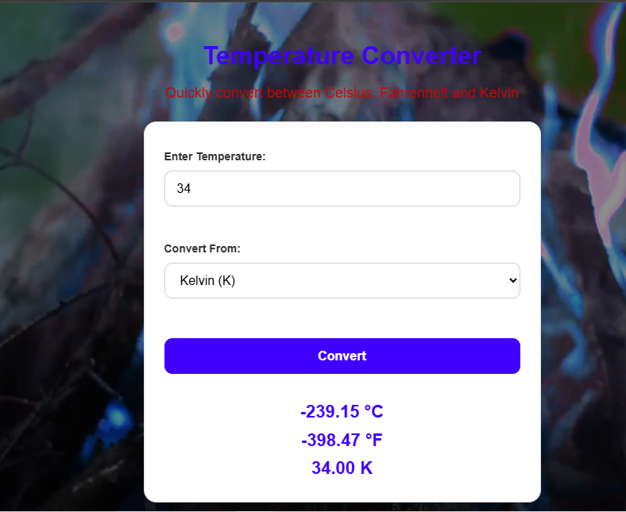

# OIBSIP - Web Development & Designing - Task 3: Temperature Converter

Submitted for the AICTE Oasis Infobyte Student Internship Program (SIP), Web Development & Designing, Level 1.

- **Intern:** Destine Magumo
- **Task:** Task 3 - Temperature Converter
- **Live demo:** https://temperatureconverter-black.vercel.app/

## Objective

Build a temperature converter web app with HTML5, CSS3 and JavaScript that converts a value between Celsius, Fahrenheit and Kelvin.

## Steps Performed

1. Started from my earlier temperature converter and reviewed what it supported.
2. Added Kelvin as a third unit.
3. Wrote the conversion logic in JavaScript, using the formulas below.
4. Changed the result so it shows the value in all units at once.
5. Added an absolute zero check, so a temperature below absolute zero shows an error instead of a result.
6. Tested normal values and edge cases such as -273.15 C, 0 K and -459.67 F.
7. Pushed the project to GitHub and deployed it on Vercel.

## Conversion Formulas

| Conversion | Formula |
| --- | --- |
| Celsius to Fahrenheit | F = C x 9/5 + 32 |
| Celsius to Kelvin | K = C + 273.15 |
| Fahrenheit to Celsius | C = (F - 32) x 5/9 |
| Kelvin to Celsius | C = K - 273.15 |

Absolute zero is 0 K, which is -273.15 C or -459.67 F. Nothing can be colder than this.

## Tools Used

- HTML5
- CSS3
- JavaScript
- Visual Studio Code
- Git and GitHub
- Vercel (hosting)

## Outcome

A working converter, live at the link above, that supports Celsius, Fahrenheit and Kelvin, shows all results at once and rejects values below absolute zero.

## Notes

This project began as an earlier personal project. For the internship I added Kelvin support, the all-units result and the absolute zero check.

<!-- Add a screenshot of the converter here:

-->

## Contact

Email: magumodestiny@gmail.com | GitHub: [magumodestin](https://github.com/magumodestin) | LinkedIn: [Destine Magumo](https://www.linkedin.com/in/destine-magumo-913571329/)
